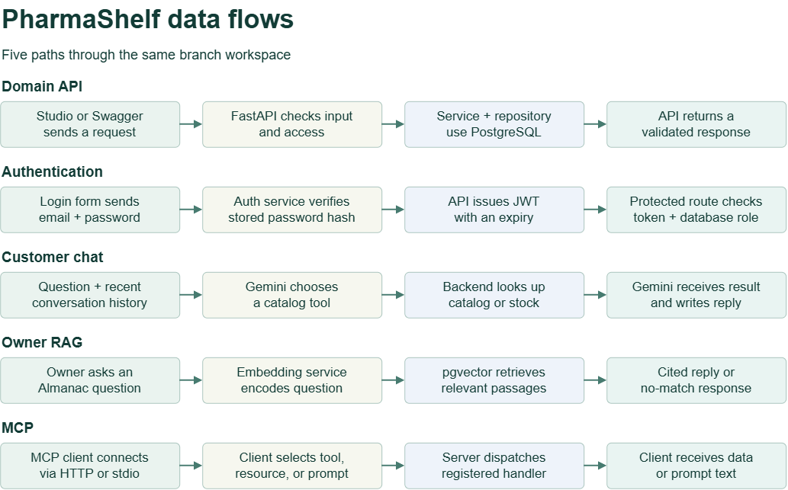

# PharmaShelf

*Know what to stock before the shelf is empty.*

[Open the live PharmaShelf Studio](https://pharmashelf.onrender.com/studio/) · [Explore the API in Swagger](https://pharmashelf.onrender.com/docs)

## One owner, two branches, one stock decision

Imagine you own two neighborhood pharmacies in Bangladesh. At the second branch, a customer asks, “Do you have paracetamol?” The pharmacist sells the last strip. The notebook captures that sale. Tomorrow, when another customer walks away empty-handed, there may be no entry at all.

One shelf down, a different lot is barely moving. In one PharmaShelf demo report, **17 units had 14 days left before expiry**. At **৳3.50 per unit**, that put **৳59.50 of stock at risk**. The owner still had time to move the lot forward, check recent sales, or ask the supplier about an exchange.

PharmaShelf is built for independent pharmacy owners in Bangladesh, especially those looking after two or three branches. The **owner** is the buyer and decides what to order. The **pharmacist** needs a quick way to record stock moving across the counter. The **customer** wants to know whether a trip to the shop is worthwhile. The business goal is to help the owner catch shortages and slow-moving stock early enough to act.

**Proposed business model.** A monthly subscription per pharmacy, an additional fee for extra branches, and optional one-time help importing historical Excel records.

## Try the live demo

Start in **Availability** and ask **“Is paracetamol available at DEMO-01?”** Anyone can try this without signing in. Then open **Reports**, enter the demo owner credentials below, and request the **30-day expiry report** for **DEMO-01**. You can sign in directly in Studio.

| Demo account | Email | Password |
|---|---|---|
| Owner | owner@pharmashelf.example.com | Demo-Owner-7Qm4-2026! |
| Pharmacist | staff@pharmashelf.example.com | Demo-Staff-9Kp2-2026! |
| Customer | customer@pharmashelf.example.com | Demo-Customer-3Vr8-2026! |

The demo uses shared sample records. Confirming a sale or stock import changes the figures later visitors see.

| Studio tab | What to try |
|---|---|
| **Availability** | Ask about a medicine and branch. The customer sees availability while quantities, prices, and sales totals stay private. |
| **Reports** | Choose DEMO-01. Review lots approaching expiry, rank best sellers by units or revenue, or compare a medicine’s sales across periods. |
| **Counter** | Record an incoming batch or a sale. A confirmed sale reduces the remaining quantity of the selected batch. |
| **Imports** | Choose a sales or stock workbook, download its template, and preview the file. Match custom column names and review row-level errors before confirming. |
| **Almanac** | Search for “expiring” to find a branch procedure and its source note. To try a generated answer with citations, open the owner chat operation in Swagger. |

## How data moves through PharmaShelf

Follow one batch through the diagram:

1. **Stock arrives.** A counter entry or confirmed stock workbook identifies the medicine, branch, lot, quantity received, unit cost, and expiry date. PostgreSQL keeps the batch linked to its medicine and branch.
2. **A sale changes the shelf.** FastAPI validates the request. The sales service locks the batch, checks that it can supply the requested units, records the sale, and reduces the remaining quantity in one transaction. Repeating an identical sale ID leaves the stock count unchanged. Reusing the ID for a different sale produces a conflict.
3. **The owner reads the numbers.** Reports use recorded sales to calculate units and revenue for the selected branch and period. The expiry report uses remaining units and recorded **unit cost** to show the purchase value still exposed. This is why a sale changes both the stock count and the amount at risk.
4. **A customer checks the branch.** Customer chat can look up a medicine by name, resolve its catalog identifier (SKU), and check availability at the requested branch. Gemini uses the returned result to phrase the answer.
5. **The owner asks what to do.** The Almanac supplies written guidance for questions such as “Which expiring batch should I review first?” The answer links back to the passages that support it.

Owner workflows use a login token. The API checks the role before returning an owner report or accepting a workbook. Previewing a workbook shows what would be imported. Confirmation is the step that writes the records.

## How the Almanac answers “why” with RAG

Retrieval-augmented generation (RAG) lets the assistant use the pharmacy’s own written procedures. During ingestion, PharmaShelf splits each Almanac entry into overlapping passages. An embedding model converts each passage into a 384-dimensional vector, a numerical representation of its meaning. PostgreSQL stores those vectors with the passages and their source information using pgvector.

When an owner asks a question, the same model embeds the question. PharmaShelf searches active passages by cosine distance and checks whether the closest results are relevant enough to use. Gemini receives the matching text, and the API connects its numbered citations to the corresponding source notes.

For **“How should I choose which expiring batch to review first?”**, the demo returned *Which expiring lot deserves attention first?* The entry suggests weighing the remaining stock value against the time to expiry and recent sales pace. An unrelated question about tuning a violin returned a no-match response with an empty source list. The assistant covers pharmacy operations. Clinical questions belong with a pharmacist or doctor.

## How other assistants use MCP

The Model Context Protocol (MCP) gives a compatible assistant access to two live catalog tools. **search_medicines** finds catalog matches by name, generic name, or SKU. **check_availability** takes an exact SKU and branch code and returns the availability flag. For example, a client can resolve “paracetamol” to **DEMO-PARA-500**, then check it at **DEMO-01**.

The MCP server also offers a live demo availability resource and a reusable lookup prompt. It supports Streamable HTTP and local stdio. External clients use MCP to read current catalog and availability data. Owner chat uses RAG to retrieve written guidance. [Hosted MCP endpoint](https://pharmashelf.onrender.com/mcp)

## Where to look in the repository

| File or directory | What it does |
|---|---|
| [app/frontend/](app/frontend/) | Contains the five-tab Studio interface and its forms for availability, reports, counter entries, imports, and Almanac search. |
| [app/main.py](app/main.py) | Assembles the FastAPI application, serves Studio, and connects the HTTP MCP service. |
| [app/api/v1/router.py](app/api/v1/router.py) | Brings the feature routes together under the versioned API. |
| [app/modules/imports/](app/modules/imports/) | Reads Excel workbooks, maps headings, validates rows, builds previews, and confirms sales or stock imports. |
| [app/modules/sales/](app/modules/sales/) and [app/modules/inventory/](app/modules/inventory/) | Record sales and batches and calculate the figures used in branch reports. |
| [app/modules/auth/](app/modules/auth/) | Handles sign-in, user identity, and role checks. |
| [app/modules/chat/](app/modules/chat/) and [app/integrations/llm/gemini.py](app/integrations/llm/gemini.py) | Connect customer questions to catalog tools and owner questions to answers grounded in Almanac passages. |
| [scripts/ingest_almanac.py](scripts/ingest_almanac.py) and [app/modules/almanac/retrieval.py](app/modules/almanac/retrieval.py) | Prepare the searchable passage index and retrieve relevant passages for a question. |
| [app/mcp_server.py](app/mcp_server.py) | Defines the two MCP tools, the availability resource, and the lookup prompt. |
| [scripts/start_render.py](scripts/start_render.py) and [alembic/versions/](alembic/versions/) | Prepare the hosted application at startup and track database schema changes. |